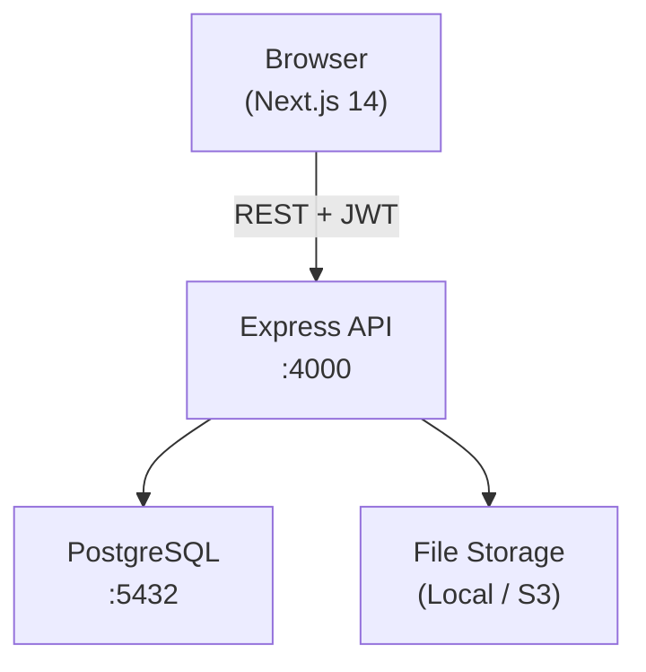
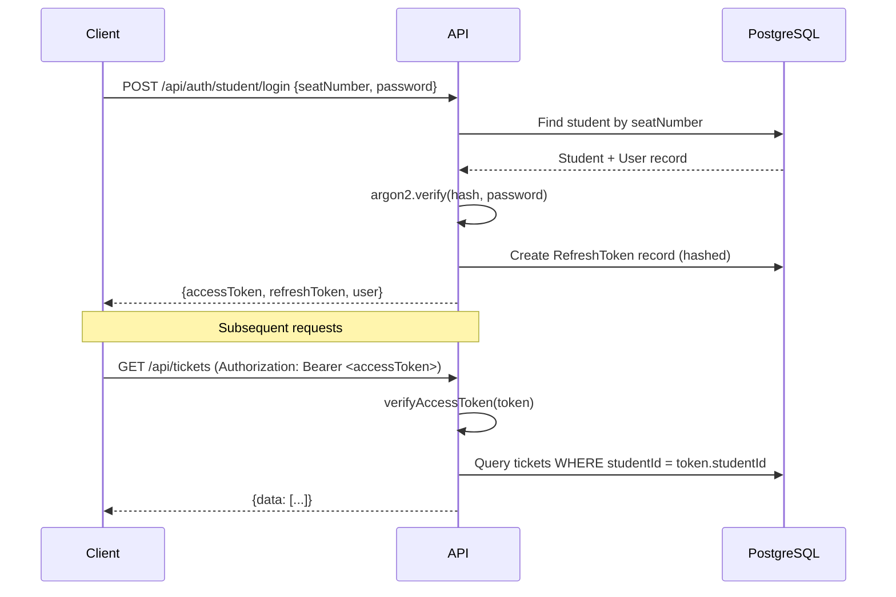

# System Architecture

## Overview



## Monorepo Layout

```
university-student-portal/
├── apps/api          Express REST API
├── apps/web          Next.js 14 frontend
├── packages/types    Shared TypeScript types + enums
└── packages/validation  Shared Zod schemas
```

## Authentication Flow



## Authorization Layers

| Role | Scope |
|---|---|
| STUDENT | Own tickets, own applications only |
| STAFF | Department tickets + office applications only |
| ADMIN | Full system access |

## Module Structure (Backend)

```
src/modules/
├── auth/          Login, refresh, logout, /me
├── departments/   List, create, update
├── issues/        List by dept, create, update
├── tickets/       Full CRUD + attachments + remarks + status history
├── applications/  Full workflow + PDF voucher + receipt upload
├── students/      Profile, dashboard stats
├── staff/         Department dashboard
└── admin/         System-wide stats, CRUD, reports, audit logs
```
